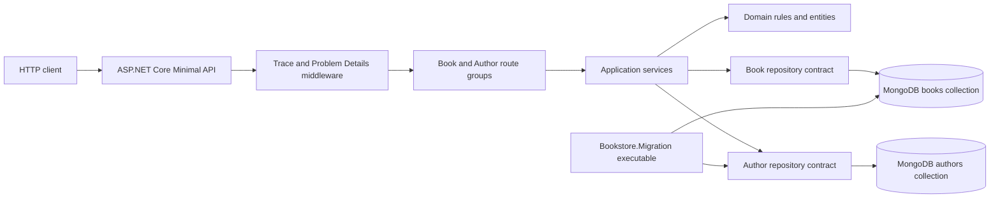
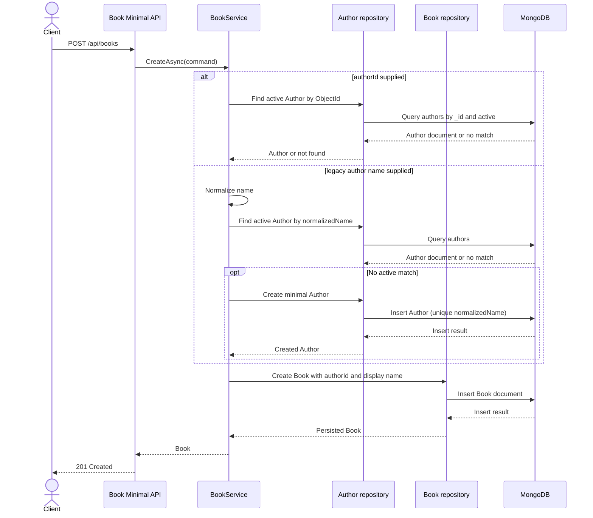
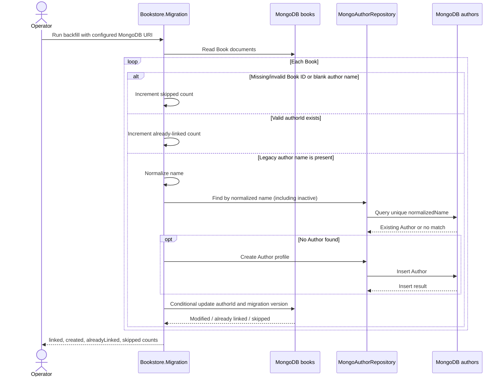

# Technical Architecture

## Runtime and dependencies

- .NET 10 Minimal API hosted by ASP.NET Core.
- MongoDB 7.0 using the official MongoDB C# driver.
- Serilog for structured JSON logging and FluentValidation for HTTP request validation.
- xUnit, `WebApplicationFactory<Program>`, and Testcontainers for integration testing.
- Built-in OpenAPI generation; Scalar is mapped only in Development.

## Project layout

```text
src/
├── Bookstore.Api/             # Route groups, request/response records, middleware
├── Bookstore.Application/     # Use cases and repository contracts
├── Bookstore.Domain/          # Book and Author entities and business rules
└── Bookstore.Infrastructure/  # MongoDB adapters, indexes, migration
tests/Bookstore.Tests/         # Unit and MongoDB-backed integration tests
tools/Bookstore.Migration/     # One-shot legacy Author backfill executable
```

The Author aggregate owns profile identity and lifecycle. A Book stores an optional `authorId` reference and a compatibility `author` display value. Soft deletion is intentionally independent: it does not cascade to Books. Repository interfaces keep application use cases independent of MongoDB.

## Runtime architecture



The API host maps the route groups and registers MongoDB infrastructure. Endpoint handlers
translate HTTP records to application calls. Application services enforce use-case
decisions and use repository contracts; MongoDB repositories persist documents. Domain
entities enforce their own invariants. The separate migration executable reads legacy
Book documents and uses the Author repository when it creates or locates profiles.

## Author-name Book search

`GET /api/books` accepts `authorName` for case-insensitive literal substring matching
against the Book's stored `author` display-name field. The Application service trims the
value, ignores it when blank, and rejects a search term longer than 255 characters before
database access. The MongoDB repository escapes the text before constructing a
case-insensitive regular-expression predicate, and combines it with category, `authorId`,
and the legacy exact `author` predicate using AND semantics.

The query works for linked and legacy Books, including Books whose Author profile is
inactive. It does not change stored data. The existing list operation is unpaged, and
substring matching does not use a dedicated index; large catalogs may require pagination
and a separately designed search index.

## Book creation and Author resolution



An explicit Author ID takes precedence over the legacy name. The API validates the
request, while the domain and application layers continue to enforce business invariants.
An inactive or unknown explicit Author is not accepted for a new Book association.

## Author soft deletion

```mermaid
sequenceDiagram
    actor Client
    participant API as Author Minimal API
    participant Service as AuthorService
    participant Repo as MongoAuthorRepository
    participant DB as MongoDB
    Client->>API: DELETE /api/authors/{id}
    API->>Service: DeactivateAsync(id)
    Service->>Repo: DeactivateAsync(id, updatedAt)
    Repo->>DB: Find Author by _id
    DB-->>Repo: Existing Author
    alt Author is active
        Repo->>DB: Set active=false and updatedAt
        DB-->>Repo: Update result
    else Author already inactive
        Note over Repo,DB: No further state change; operation remains idempotent
    end
    Repo-->>Service: Success or not found
    Service-->>API: Result
    API-->>Client: 204 No Content or 404 Problem Details
    Note over DB: Linked Book documents are not modified
```

Default Author queries filter inactive profiles. Supplying `includeInactive=true` removes
that filter. Soft deletion only updates the Author document; the Book repository is not
called by this flow.

## Persistence

The existing `bookstore.books` collection is retained. The API adds `bookstore.authors`, a unique ascending index on `normalizedName`, and an ascending index on `books.authorId`. `_id` and `authorId` are BSON ObjectIds; JSON contracts expose 24-character hexadecimal strings.

The Author backfill reads legacy Book documents, normalizes nonblank author names, creates or reuses Author records, and links Books without changing their legacy author value or other catalog fields. It preserves valid existing references, repairs malformed `authorId` values using a conditional update, and counts skipped documents. The migration is safe to rerun.



The conditional Book update protects a concurrent valid `authorId` from being overwritten.
Running the tool again reuses normalized Author records and counts Books with a valid
reference as already linked.

Run the one-shot backfill with `MONGODB_URI` or `MongoDb__ConnectionString` set:

```sh
MONGODB_URI=mongodb://localhost:27017 dotnet run --project tools/Bookstore.Migration
```

Back up the database and rehearse the backfill against a representative copy before production execution.

## Configuration and operations

- `MongoDb:ConnectionString` (environment form `MongoDb__ConnectionString`) or `MONGODB_URI`: required, never logged.
- `MongoDb:DatabaseName` (environment form `MongoDb__DatabaseName`): optional; defaults to `bookstore`.
- `ASPNETCORE_URLS`: controls listener URLs; Compose maps port 8080.

The API initializes indexes at startup and fails explicitly if MongoDB settings are missing
or index initialization fails. Serilog emits JSON logs and enriches events with the request
trace ID from the logging scope. FluentValidation checks incoming create/update request
records at the API boundary; domain validation remains authoritative for business
invariants. Middleware maps request validation failures to RFC 7807 Problem Details with
400 and returns a generic client response for unexpected exceptions.

## API contract

The maintained contract is [contracts/openapi.yaml](../specs/007-author-management/contracts/openapi.yaml). Runtime OpenAPI JSON is available at `/openapi/v1.json`; the Development-only Scalar UI is available at `/scalar/v1`.

## Security and privacy

There is no authentication/authorization layer in the current requirements. Do not expose the service publicly without a gateway or a separately approved authentication design. Keep production credentials in a secret store/environment injection, not in source control. Error logs do not include client-provided validation details; internal failures retain server-side exception details.

Known operational and migration follow-ups are tracked in the [technical-debt register](./technical-debt.md).
